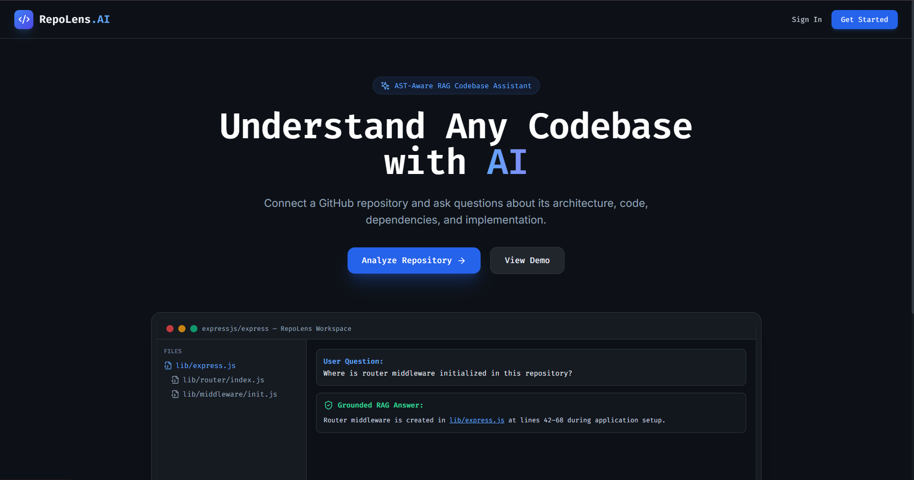
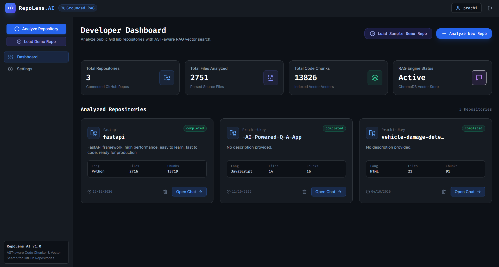
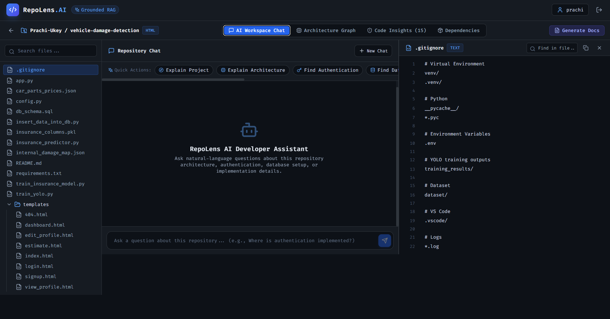

# RepoLens AI — GitHub Repository Intelligence Platform

RepoLens AI is a production-ready, AI-powered codebase intelligence platform that enables developers to understand public GitHub repositories through natural-language questions grounded in verified code citations. It combines Retrieval-Augmented Generation (RAG), Abstract Syntax Tree (AST) parsing, hybrid semantic and keyword search, and flexible LLM integrations (local Ollama models and cloud providers) to generate accurate answers with verifiable file paths and exact line ranges.

---

## 📸 Application Screenshots

### Dashboard


### Repository Analysis


### AI Chat with Verified Code References


---

## 🚀 Key Features

- **GitHub Repository Ingestion & Analysis** — Clones, parses, and indexes public GitHub repositories for code navigation and Q&A.
- **AST-Aware Code Parsing** — Deconstructs Python source code into classes, functions, and modules, preserving symbol names, docstrings, and exact line boundaries.
- **Hybrid RAG Pipeline** — Combines vector similarity search (ChromaDB) with keyword/symbol matching to retrieve the most relevant source snippets.
- **Strict Citation Verification** — Validates every generated citation against current repository source lines to guarantee zero fabricated references or- **Multi-Provider LLM Engine**:
  - **Local Ollama** (default development): zero-cost local inference with `qwen2.5-coder:1.5b` or `qwen2.5-coder:7b`.
  - **Google Gemini**: cloud-ready inference with `gemini-2.5-flash` or `gemini-1.5-pro` (authenticated securely via `x-goog-api-key` header with exponential backoff & jitter).
  - **OpenAI**: cloud-ready inference with `gpt-4o-mini` or `gpt-4o`.
  - **Mock LLM**: deterministic fallback for unit testing and zero-resource environments.
- **Sustainable Free-Tier Embedding Architecture**:
  - **Local Sentence Transformers (`all-MiniLM-L6-v2`)**: Default 384-dimensional local embeddings with thread-safe lazy singleton loading, deterministic batching, and zero external API dependencies or token quotas.
  - **Safe Dimension Migration**: Automatic detection and safe rebuilding of vector collections when switching models or dimensions (e.g. from 768-d Gemini to 384-d MiniLM) without data loss or collection crashes.
- **Repository Isolation & Persistence** — Independent SQLite and ChromaDB collections per repository, preventing cross-repo data leakage.
- **User Authentication & Session Management** — Secure user registration and login with bcrypt password hashing and JWT access tokens.
- **Production-Ready Web Deployment** — Pre-configured for deployment on **Vercel** (frontend) and **Render** (backend) with explicit free-tier memory and storage guidance.

---

## 🏗️ Architecture & Data Flow

```text
                                  +---------------------------------------+
                                  |         User Browser / Client         |
                                  |   (React 18 + Vite + Tailwind CSS)    |
                                  +---------------------------------------+
                                                      |
                                                      | HTTP / SSE (EventSource)
                                                      v
                                  +---------------------------------------+
                                  |          FastAPI Backend API          |
                                  |   (Uvicorn + Pydantic + SQLAlchemy)   |
                                  +---------------------------------------+
                                           /          |          \
                 Ingestion / Sync         /           |           \ Query / RAG
                                         v            |            v
+------------------------------------------+          |   +----------------------------------+
|            Ingestion Service             |          |   |            RAG Engine            |
| - Git Clone / Fetch                      |          |   | - Question Classifier            |
| - Language Detection                     |          |   | - Query Formulation              |
| - AST Code Parser (Chunking)             |          |   | - Hybrid Retrieval               |
+------------------------------------------+          |   +----------------------------------+
                     |                                |            /                \
                     v                                |           /                  \
+------------------------------------------+          |          v                    v
|           Embedding Pipeline             |          |   +---------------+   +------------------+
| - Local all-MiniLM-L6-v2 (384-d, Free)   |          |   | Vector Search |   | Keyword / SQLite |
|   Lazy Singleton & Thread-Safe Cache     |          |   |  (ChromaDB)   |   |   (Source Files) |
+------------------------------------------+          |   +---------------+   +------------------+
                     |                                |           \                  /
                     v                                |            \                /
+------------------------------------------+          |             v              v
|              Storage Layer               |          |   +----------------------------------+
| - SQLite: repos, files, users, chats     |<---------+   |       Context Construction       |
| - ChromaDB: 384-d vector embeddings      |              +----------------------------------+
+------------------------------------------+                               |
                                                                           v
                                                          +----------------------------------+
                                                          |           LLM Provider           |
                                                          | - Ollama (host.docker.internal)  |
                                                          | - Gemini (x-goog-api-key header) |
                                                          | - OpenAI (gpt-4o-mini)           |
                                                          +----------------------------------+
                                                                           |
                                                                           v
                                                          +----------------------------------+
                                                          |  Citation Validator & Formatter  |
                                                          | - AST / Source Line Validation   |
                                                          | - Groundedness Verification      |
                                                          +----------------------------------+
                                                                           |
                                                                           v
                                                               Verified Stream to Frontend
```

---

## 💻 Technology Stack

| Layer | Technologies |
|---|---|
| **Frontend** | React 18, Vite, Tailwind CSS, React Router v6, Axios, Lucide React |
| **Backend** | Python 3.11+, FastAPI, Uvicorn, SQLAlchemy, SQLite, Pydantic, python-jose (JWT), passlib (bcrypt) |
| **AI / RAG** | ChromaDB, Sentence Transformers (`all-MiniLM-L6-v2`), Ollama (`qwen2.5-coder:1.5b`), Google Generative AI (Gemini Flash), OpenAI SDK, Python AST |
| **DevOps / Containers** | Docker, Docker Compose, Nginx, Vercel (Frontend), Render (Backend) |

---

## ⚙️ Environment Variables

### Backend Configuration (`backend/.env`)

| Variable | Default Value | Description |
|---|---|---|
| `APP_ENV` | `development` | Environment mode (`development` or `production`) |
| `DATABASE_URL` | `sqlite:///./repolens.db` | SQLAlchemy database URL (ephemeral `./repolens.db` on Render free tier, or `/var/data/repolens.db` with persistent disk) |
| `CHROMA_PERSIST_DIRECTORY` | `./chroma_data` | Directory where ChromaDB indexes are stored |
| `SECRET_KEY` | *(dev fallback in dev)* | JWT token signing key. **Required in production** (min 16 chars). Application fails fast on startup if missing, default, or placeholder in production. |
| `ACCESS_TOKEN_EXPIRE_MINUTES` | `10080` | JWT token lifetime (7 days) |
| `CORS_ORIGINS` | `http://localhost:5173,http://localhost:3000` | Allowed frontend origins. In production, **must match exact deployed frontend origin** (not `*`) when credentials are enabled. |
| `LLM_PROVIDER` | `gemini` (or `ollama`) | Active LLM (`gemini`, `ollama`, `openai`, or `mock`) |
| `OLLAMA_BASE_URL` | `http://host.docker.internal:11434` | Ollama API endpoint (`http://localhost:11434` for bare-metal) |
| `OLLAMA_MODEL` | `qwen2.5-coder:1.5b` | Ollama model identifier |
| `OLLAMA_TIMEOUT` | `120.0` | Ollama HTTP request timeout in seconds |
| `GEMINI_API_KEY` | *(optional)* | Google Gemini API key. Passed via `x-goog-api-key` header with exponential backoff & jitter. |
| `GEMINI_MODEL` | `gemini-2.5-flash` | Gemini model name |
| `OPENAI_API_KEY` | *(optional)* | OpenAI API key for hosted deployment |
| `OPENAI_MODEL` | `gpt-4o-mini` | OpenAI model name |
| `EMBEDDING_PROVIDER` | `local` | Embedding engine (`local`, `mock`, `openai`, `gemini`). Default is `local` (free `all-MiniLM-L6-v2`, zero API quota). |
| `EMBEDDING_DIMENSION` | `384` | Embedding dimensionality (384 for `local` and `mock`, 768 for `gemini`, 1536 for `openai`). |

### Frontend Configuration (`frontend/.env` or Vercel Environment)

| Variable | Default Value | Description |
|---|---|---|
| `VITE_API_BASE_URL` | `/api` | Base URL of the backend API (set to Render URL in production) | (set to Render URL in production) |

---

## 🛠️ Local Development Setup

### Prerequisites
- **Python 3.11+** installed
- **Node.js 18+** and **npm** installed
- **Git** installed
- **Ollama** installed on your host machine ([Download Ollama](https://ollama.com/download))

### 1. Configure and Start Ollama

Start the Ollama daemon and pull the recommended coding model:
```bash
ollama serve
ollama pull qwen2.5-coder:1.5b
```

Verify that the model is ready:
```bash
ollama list
```

### 2. Set Up the Backend (Native / Local Virtualenv)

```bash
cd backend
python -m venv venv

# Windows PowerShell:
.\venv\Scripts\Activate.ps1

# Linux / macOS:
source venv/bin/activate

# Install dependencies:
pip install -r requirements.txt

# Start backend server:
uvicorn app.main:app --host 127.0.0.1 --port 8000 --reload
```
- API Docs: [http://localhost:8000/docs](http://localhost:8000/docs)
- Health Check: [http://localhost:8000/health](http://localhost:8000/health)

### 3. Set Up the Frontend

In a separate terminal:
```bash
cd frontend
npm install
npm run dev
```
- Frontend UI: [http://localhost:5173](http://localhost:5173)

---

## 🐳 Running with Docker Compose

Docker Compose runs both frontend and backend in isolated containers while connecting seamlessly to Ollama running on your Windows host.

### Windows Host Configuration
In `docker-compose.yml`, the backend communicates with Ollama via `host.docker.internal`:
```yaml
environment:
  - LLM_PROVIDER=ollama
  - OLLAMA_BASE_URL=http://host.docker.internal:11434
  - OLLAMA_MODEL=qwen2.5-coder:1.5b
  - EMBEDDING_PROVIDER=mock
  - EMBEDDING_DIMENSION=384
```

### Start Containers
```bash
docker compose up -d --build
```

### Check Logs & Health
```bash
docker compose logs -f backend
```
- Frontend: [http://localhost:3000](http://localhost:3000)
- Backend: [http://localhost:8000](http://localhost:8000)
- Health Check: [http://localhost:8000/health](http://localhost:8000/health)

To stop services without deleting persistent volumes:
```bash
docker compose down
```
*(Never pass `-v` to preserve repository databases and indexed vector data).*

---

## 🧪 Automated Testing

RepoLens AI includes a comprehensive automated test suite covering unit, integration, and RAG retrieval functionality:

```bash
cd backend

# Run full backend test suite (150 tests):
.\venv\Scripts\python -m pytest tests/

# Run free-tier embeddings and safe migration tests:
.\venv\Scripts\python -m pytest tests/test_free_tier_embeddings_and_migration.py

# Run LLM provider integration tests:
.\venv\Scripts\python -m pytest tests/test_llm_provider_integration.py

# Verify Chroma vector index dimension compatibility:
.\venv\Scripts\python reindex_repo.py --verify-dimensions

# Rebuild any incompatible collections (e.g. legacy 768-d Gemini to 384-d local):
.\venv\Scripts\python reindex_repo.py --rebuild-incompatible

# Verify frontend production build:
cd ../frontend
npm run build
```

---

## 🔄 Vector Dimensions & Safe Model Migration

RepoLens AI stores repository embeddings in ChromaDB collections isolated per repository (`repo_{repo_id}`).
- **Local Sentence Transformers**: Produces **384-dimensional** vectors using `all-MiniLM-L6-v2`.
- **Legacy Gemini Embeddings**: Produces **768-dimensional** vectors using `text-embedding-004` / `gemini-embedding-001`.
- **OpenAI Embeddings**: Produces **1536-dimensional** vectors using `text-embedding-3-small`.

Mixing vectors of different dimensions within a Chroma collection causes runtime indexing crashes (`HTTP 500 / ValueError: embedding dimension mismatch`).

### Safe Dimension Architecture:
1. **Schema-Level Tracking**: The SQLite database records `embedding_model` and `embedding_dimension` on each repository record. Schema migrations are applied idempotently at startup without deleting existing user or repository data.
2. **Dimension Verification**: Running `python reindex_repo.py --verify-dimensions` checks both the SQLite recorded dimensions and live ChromaDB vector shapes against the configured `EMBEDDING_DIMENSION`.
3. **Safe Atomic Reindexing**: Running `python reindex_repo.py --rebuild-incompatible` recreates vector collections using existing chunks from the SQLite database with the active embedding model, using atomic temporary collection swapping so user data is never lost.

---

## 🚀 Cloud Deployment (Render & Vercel)

RepoLens AI is configured for free-tier hosting:
- **Frontend**: [Vercel](https://vercel.com) (Edge hosting with Vite SPA routing via `vercel.json`)
- **Backend**: [Render](https://render.com) (FastAPI web service configured via `render.yaml`)

For a complete step-by-step walkthrough, see [DEPLOYMENT_CHECKLIST.md](file:///DEPLOYMENT_CHECKLIST.md).

### Free-Tier Hosting Realities & Trade-Offs

| Resource | Local Desktop (Windows) | Render Free Tier (512MB RAM) | Render Starter ($7/mo) |
|---|---|---|---|
| **RAM** | Host RAM (8GB - 64GB) | **512 MB hard cap** | 512 MB - 2 GB |
| **Embeddings** | `local` (`all-MiniLM-L6-v2`) | `local` (small repos) or `mock` | `local` or external API |
| **Storage** | Persistent SSD | **Ephemeral** (clears on restart/sleep) | Persistent Disk (`/var/data`) |
| **LLM Inference** | Ollama (`qwen2.5-coder`) | Cloud API (Gemini / OpenAI) | Cloud API (Gemini / OpenAI) |
| **Cost** | **$0.00 completely free** | **$0.00 completely free** | $7+/mo |

> [!IMPORTANT]
> **Render Free Instance Ephemeral Storage**: Render's free tier spins down after 15 minutes of inactivity and restarts with a fresh container. SQLite and ChromaDB data stored in `./repolens.db` and `./chroma_data` are cleared upon container restart unless a persistent disk (paid plan) or external database (e.g. Supabase PostgreSQL) is connected.
>
> **Render 512MB Memory Constraint**: Loading PyTorch runtime (~250MB) + `all-MiniLM-L6-v2` (~90MB) + FastAPI and ChromaDB (~150MB) operates near the 512MB limit. To ensure stability on free Render instances:
> - The local embedding model uses thread-safe lazy singleton loading so memory is only allocated when an ingestion job runs.
> - Batch size is bounded to 32 items to avoid memory spikes.
> - If deploying purely for UI/portfolio demonstration with minimal RAM usage, set `EMBEDDING_PROVIDER=mock`.

---

## 🔧 Troubleshooting Guide

### 1. Gemini Embedding API Error (HTTP 429: RESOURCE_EXHAUSTED)
- **Cause**: Google AI Studio free-tier Gemini Embeddings enforce a strict 30,000 TPM limit. Ingesting a large codebase exhausts this limit immediately.
- **Solution**: Switch to free local embeddings:
  ```env
  EMBEDDING_PROVIDER=local
  EMBEDDING_DIMENSION=384
  ```
  Local embeddings run entirely on your CPU without any external rate limits or token charges.

### 2. Vector Dimension Mismatch Error
- **Cause**: Repository was previously indexed with 768-d Gemini vectors, but the active provider is 384-d `all-MiniLM-L6-v2`.
- **Solution**: Run the safe reindex command:
  ```powershell
  python reindex_repo.py --rebuild-incompatible
  ```

### 3. Model Download Issues / Offline Mode
- **Cause**: On first run with `EMBEDDING_PROVIDER=local`, Sentence Transformers automatically downloads the `all-MiniLM-L6-v2` weights (~90MB) from Hugging Face Hub. If offline without cached weights, an informative `RuntimeError` is raised.
- **Solution**: Ensure internet access on the first run. The model is cached locally at `~/.cache/huggingface/hub/` and subsequent runs operate completely offline.

---

## 📋 Common Repository Questions Supported

RepoLens AI is specifically optimized to answer:
1. **Repository Overview**: *"What is this repository and what is its main purpose?"*
2. **Tech Stack & Dependencies**: *"Which programming languages, frameworks, and technologies does it use?"*
3. **Project Structure**: *"Explain the folder and file structure."*
4. **File Purpose**: *"What is the purpose of `backend/app/ai/rag.py`? Explain its main responsibilities."*
5. **Function & Class Anatomy**: *"Explain the purpose of `RAGEngine` and its execution flow."*
6. **Feature Implementation**: *"Where is JWT authentication implemented?"*
7. **API Endpoints**: *"Which file contains the repository analysis API endpoints?"*
8. **Client-Server Communication**: *"How does the frontend communicate with the backend?"*

Every response includes exact file paths and line number ranges checked against actual source files.

---

## ⚠️ Known Limitations

- **Render Free Tier Storage**: SQLite databases and vector collections do not persist across free Render instance spin-downs.
- **Language Support**: Deep AST structural parsing is currently optimized for Python. Other languages are indexed using line-aware text and symbol chunking.
- **Dynamic Reflection**: Dynamically imported or runtime-evaluated dependencies cannot be parsed statically.
- **Local LLM Speed**: Ollama inference speed depends on your host GPU/CPU. For 8GB RAM systems, `qwen2.5-coder:1.5b` is strongly recommended.
