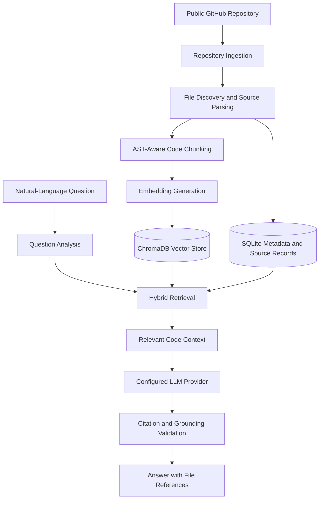

# 🔍 RepoLens AI — GitHub Repository Intelligence Platform

<p align="center">
  <strong>Understand any public GitHub codebase through natural-language questions and source-grounded AI answers.</strong>
</p>

<p align="center">
  <a href="https://repolens-ai-kappa.vercel.app/"><strong>🚀 Live Demo</strong></a> ·
  <a href="https://repolens-backend-7ui1.onrender.com/docs"><strong>📚 API Documentation</strong></a> ·
  <a href="https://github.com/Prachi-Ukey/repolens-ai"><strong>💻 Source Code</strong></a>
</p>

<p align="center">
  
  
  
  
  
  
</p>

---

## ✨ Overview

**RepoLens AI** is an AI-powered GitHub repository intelligence platform that helps developers explore, understand, and analyze codebases using natural-language questions.

Instead of manually navigating hundreds of files, developers can connect a public GitHub repository, analyze its source code, and ask questions about its architecture, functions, dependencies, APIs, and implementation details.

Built around **Retrieval-Augmented Generation (RAG)**, AST-aware code parsing, hybrid retrieval, and citation validation, RepoLens AI aims to produce answers grounded in repository evidence rather than unsupported AI-generated explanations.

### 🎯 Why RepoLens AI?

Understanding an unfamiliar codebase can be time-consuming, especially when it contains many files, functions, and dependencies. RepoLens AI streamlines this process by connecting natural-language questions with relevant source code and file-level evidence.

**The goal:** Make codebase exploration faster, more accessible, and easier to verify.

## 🚀 Live Demo

| Resource | Link |
|---|---|
| 🌐 Frontend Application | [Launch RepoLens AI](https://repolens-ai-kappa.vercel.app/) |
| ⚙️ Backend API | [Open Backend](https://repolens-backend-7ui1.onrender.com/) |
| 📚 Interactive API Docs | [FastAPI Swagger UI](https://repolens-backend-7ui1.onrender.com/docs) |
| ❤️ Health Check | [Check Backend Status](https://repolens-backend-7ui1.onrender.com/health) |
| 💻 GitHub Repository | [View Source Code](https://github.com/Prachi-Ukey/repolens-ai) |

> **Note:** The backend runs on Render's free tier and may need time to wake up after inactivity. Repository indexes and analysis data can also be lost when an ephemeral instance restarts.

## 📸 Application Screenshots

### Dashboard


### Repository Analysis


### AI Chat with Code References


> Ensure these image files exist at the specified paths in the repository. GitHub displays the screenshots directly in this README.

## ⭐ Key Features

- **GitHub Repository Analysis** — Connect public GitHub repositories and explore their source code and project structure.
- **AST-Aware Code Parsing** — Extract Python functions, classes, modules, and code regions while preserving useful source locations.
- **Retrieval-Augmented Generation (RAG)** — Retrieve relevant repository context before generating answers.
- **Hybrid Code Retrieval** — Combine semantic vector search with keyword and symbol-based retrieval.
- **Evidence-Based Answers** — Provide file paths and line-range citations that can be checked against repository source.
- **Citation and Grounding Validation** — Validate generated source references and assess whether answers are supported by retrieved evidence.
- **Multiple LLM Providers** — Support configurable local and cloud-based language model integrations, depending on deployment configuration.
- **Local Embeddings** — Use a compact 384-dimensional MiniLM embedding model in the configured ONNX Runtime production environment.
- **Repository Isolation** — Keep repository records, code chunks, and vector collections separated by repository.
- **Authentication** — Support user registration, login, password hashing, and JWT-based access tokens.
- **Interactive Developer Interface** — Explore repositories and ask questions through a React-based interface.
- **Docker Support** — Run the application with containerized services using Docker Compose.
- **Automated Tests** — Test retrieval behavior, citation parsing, streaming responses, and other application functionality.

## 🧠 How It Works



### 🔎 RAG Pipeline

1. **Ingestion:** Retrieve repository files and identify relevant source code.
2. **Parsing:** Extract useful code structures and split source into searchable chunks.
3. **Indexing:** Generate embeddings and store vector representations with repository metadata.
4. **Retrieval:** Use semantic similarity and keyword or symbol matching to find relevant context.
5. **Generation:** Supply the retrieved context to the configured language model.
6. **Validation:** Check generated citations against source information and evaluate evidence support.
7. **Response:** Return the answer and associated file references to the frontend.

## 🏗️ Architecture

| Layer | Responsibility |
|---|---|
| Frontend | Repository dashboard, analysis views, chat interface, and API communication |
| Backend API | Authentication, repository operations, analysis requests, and response streaming |
| Ingestion Pipeline | Repository retrieval, file discovery, parsing, and chunk creation |
| Retrieval Engine | Query analysis, semantic search, keyword matching, and context selection |
| Embedding Pipeline | Convert code chunks into vector representations |
| Vector Store | Store and retrieve code embeddings using ChromaDB |
| Database | Store application records and repository metadata using SQLite |
| LLM Integration | Generate answers using the configured local or cloud model |
| Evidence Validation | Validate citations and determine whether the retrieved evidence supports an answer |

## 🛠️ Technology Stack

| Category | Technologies |
|---|---|
| Frontend | React, Vite, Tailwind CSS, React Router, Axios, Lucide React |
| Backend | Python, FastAPI, Uvicorn, SQLAlchemy, Pydantic |
| AI / RAG | Retrieval-Augmented Generation, Python AST, ChromaDB, hybrid retrieval |
| Embeddings | MiniLM, ONNX Runtime, Sentence Transformers ecosystem |
| LLM Integrations | Google Gemini, Ollama, OpenAI, mock provider for testing |
| Database | SQLite, ChromaDB |
| Authentication | JWT, bcrypt-based password hashing |
| DevOps | Docker, Docker Compose, Nginx |
| Deployment | Vercel, Render |
| Testing | pytest, Node.js regression tests |

## ⚙️ Local Development Setup

### Prerequisites

Install the following tools:

- [Python](https://www.python.org/downloads/) — 3.11 or a compatible version supported by the project.
- [Node.js](https://nodejs.org/) — LTS release.
- [Git](https://git-scm.com/downloads)
- [Docker Desktop](https://www.docker.com/products/docker-desktop/) — optional, for containerized development.
- [Ollama](https://ollama.com/download) — optional, if using a local LLM.

### 1. Clone the repository

```bash
git clone https://github.com/Prachi-Ukey/repolens-ai.git
cd repolens-ai
```

### 2. Configure the backend

Create and activate a virtual environment:

**Windows PowerShell**

```powershell
cd backend
python -m venv venv
.\venv\Scripts\Activate.ps1
pip install -r requirements.txt
```

**Linux / macOS**

```bash
cd backend
python -m venv venv
source venv/bin/activate
pip install -r requirements.txt
```

Create `backend/.env` using the environment variables supported by your current backend configuration. Configure the required production or development secrets and your chosen LLM provider.

Start the API:

```bash
uvicorn app.main:app --host 127.0.0.1 --port 8000 --reload
```

Backend resources:

- API: http://localhost:8000
- Interactive API documentation: http://localhost:8000/docs
- Health check: http://localhost:8000/health

### 3. Configure the frontend

Open another terminal:

```bash
cd frontend
npm install
npm run dev
```

Open the frontend at:

http://localhost:5173

If your frontend requires an explicit backend URL, configure `VITE_API_BASE_URL` according to the application's environment configuration.

### 4. Optional: Run a local LLM

If your configuration uses Ollama, install it and pull a compatible model:

```bash
ollama pull qwen2.5-coder:1.5b
ollama list
```

Start the Ollama service if it is not already running:

```bash
ollama serve
```

Configure the backend to use the appropriate Ollama endpoint and model name. Inside Docker, `host.docker.internal` may be required to reach Ollama running on the host.

## 🐳 Run with Docker Compose

From the repository root, ensure Docker Desktop is running and review the environment settings in `docker-compose.yml`.

Build and start the services:

```bash
docker compose up -d --build
```

View service status:

```bash
docker compose ps
```

Follow backend logs:

```bash
docker compose logs -f backend
```

Stop the services:

```bash
docker compose down
```

> **Data warning:** Do not use `docker compose down -v` unless you intentionally want to remove the associated volumes and their stored data.

Use the frontend and backend ports configured in your Compose file; they may differ from the native development ports.

## 🔐 Environment Configuration

Environment variable names and defaults may vary between local development and production. Check the current backend settings and deployment configuration before changing them.

| Variable | Purpose |
|---|---|
| `APP_ENV` | Select development or production mode |
| `DATABASE_URL` | Configure the SQLAlchemy database connection |
| `CHROMA_PERSIST_DIRECTORY` | Set the ChromaDB persistence directory |
| `SECRET_KEY` | Configure secure JWT signing |
| `ACCESS_TOKEN_EXPIRE_MINUTES` | Set access-token lifetime |
| `CORS_ORIGINS` | Define permitted frontend origins |
| `LLM_PROVIDER` | Select the configured LLM provider |
| `OLLAMA_BASE_URL` | Configure the Ollama endpoint |
| `OLLAMA_MODEL` | Select the Ollama model |
| `GEMINI_API_KEY` | Configure Gemini authentication |
| `GEMINI_MODEL` | Select the Gemini model |
| `OPENAI_API_KEY` | Configure OpenAI authentication |
| `OPENAI_MODEL` | Select the OpenAI model |
| `EMBEDDING_PROVIDER` | Select the embedding implementation |
| `EMBEDDING_DIMENSION` | Configure the embedding vector dimension |

**Security recommendations**

- Never commit `.env` files, API keys, or production secrets.
- Use a strong, unique `SECRET_KEY` in production.
- Configure CORS for the actual deployed frontend origin.
- Store API credentials in your hosting provider's environment settings.
- Use the embedding provider and vector dimension supported by the active backend implementation.

## 🧪 Automated Testing

The project includes backend tests and frontend regression checks.

From the repository root, run the backend test suite:

```bash
python -m pytest backend/tests
```

Run the retrieval symbol-extraction regression tests:

```bash
python -m pytest backend/tests/test_rag_symbol_extraction_regression.py
```

Run citation parsing tests:

```bash
python -m pytest backend/tests/test_rag_compound_citations.py
```

Run the frontend streaming regression test:

```bash
node frontend/src/tests/stream_parsing_regression.test.js
```

Verify the frontend production build:

```bash
cd frontend
npm run build
```

Run only the tests relevant to a change while debugging, then run the complete suite before merging or deploying.

## 🚀 Deployment

RepoLens AI is configured for a split deployment:

| Component | Platform | Resource |
|---|---|---|
| Frontend | Vercel | [Live application](https://repolens-ai-kappa.vercel.app/) |
| Backend | Render | [Live API](https://repolens-backend-7ui1.onrender.com/) |
| API documentation | Render | [Swagger UI](https://repolens-backend-7ui1.onrender.com/docs) |
| Source code | GitHub | [Repository](https://github.com/Prachi-Ukey/repolens-ai) |

### Free-tier considerations

- **Cold starts:** The backend may sleep after a period of inactivity and take time to respond to the first request.
- **Ephemeral storage:** Data stored on a temporary Render filesystem can disappear when the instance restarts or is replaced.
- **Memory limits:** Local embedding models and vector indexing can consume significant RAM. Large repositories may exceed free-instance resources.
- **Persistent data:** Production deployments requiring durable repository indexes should use persistent storage and an appropriate database configuration.
- **API quotas:** Cloud LLM and embedding providers may enforce rate limits or usage quotas.

For additional deployment instructions, see [`DEPLOYMENT_CHECKLIST.md`](DEPLOYMENT_CHECKLIST.md) if the file exists in the repository.

## 💬 Example Questions

Ask RepoLens AI questions such as:

- What is the main purpose of this repository?
- Explain the project architecture and folder structure.
- Which Python files contain the main application logic?
- What is the purpose of `backend/app/ai/rag.py`?
- Explain the execution flow of `RAGEngine`.
- Where is authentication implemented?
- Which API endpoints handle repository analysis?
- How does the frontend communicate with the backend?
- Explain a function using its actual source code and line references.

The quality of the answer depends on repository indexing, the retrieved context, the configured model, and the evidence available.

## ⚠️ Known Limitations

- **Python-focused AST parsing:** Deep structural parsing is optimized for Python. Other languages may rely on less detailed text or symbol-based chunking.
- **Dynamic behavior:** Runtime-generated code, reflection, and dynamically resolved dependencies may not be fully understood through static analysis.
- **Retrieval quality:** Relevant code can be missed when indexing is incomplete or search ranking does not select the necessary chunks.
- **Evidence quality:** A citation is useful only when its referenced source actually supports the associated claim.
- **Free-tier hosting:** Temporary storage, cold starts, resource limits, and provider quotas can affect availability and analysis size.
- **Local inference:** Ollama response speed depends on available CPU, memory, and GPU resources.

## 🗺️ Future Enhancements

Potential improvements include:

- Broader multi-language AST support.
- More advanced hybrid retrieval and reranking.
- Persistent production storage for repository indexes.
- Expanded evaluation datasets for answer grounding and citation accuracy.
- Richer repository dependency graphs and architecture visualizations.
- Improved streaming and historical evidence-state handling.

## 🤝 Contributing

Contributions, bug reports, and suggestions are welcome.

1. Fork the repository.
2. Create a feature branch.
3. Implement and test your changes.
4. Open a pull request describing the changes.

For bugs, include reproducible steps, relevant error messages, and expected behavior. Never include secrets or access tokens in an issue.

## 📄 License

Add or link the license that is actually present in the repository. If the project uses the MIT License, include the corresponding `LICENSE` file before labeling the project as MIT-licensed.

---

<p align="center">
  <strong>Built to make unfamiliar codebases easier to understand.</strong>
  <br />
  <a href="https://repolens-ai-kappa.vercel.app/">Try RepoLens AI</a> ·
  <a href="https://github.com/Prachi-Ukey/repolens-ai">Explore the code</a>
</p>
